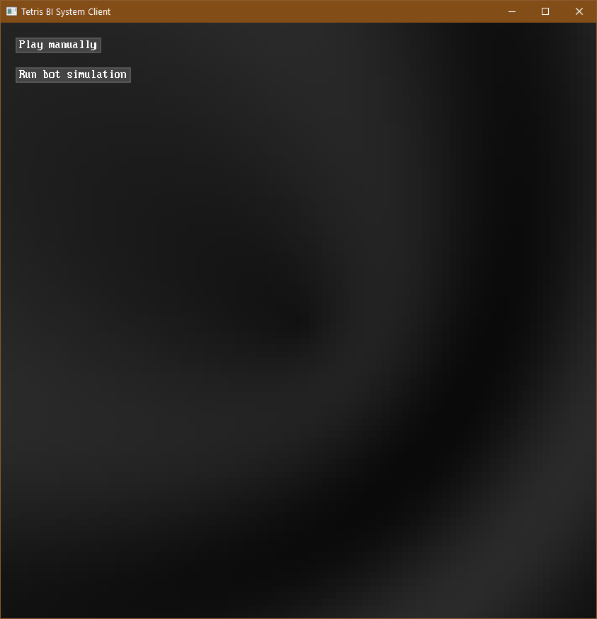
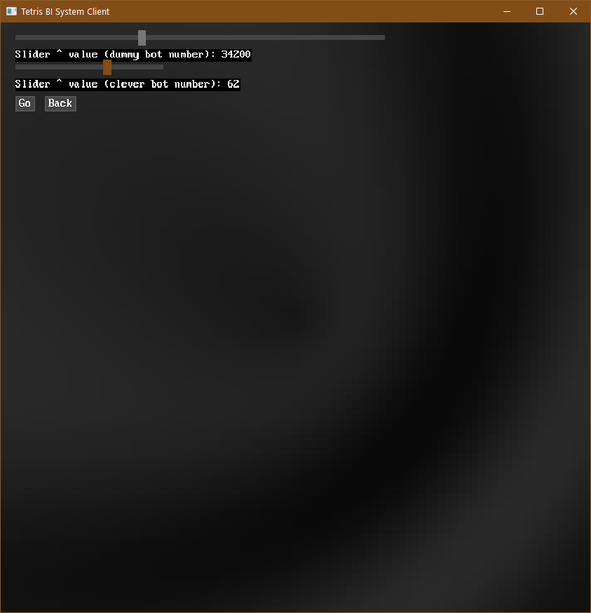
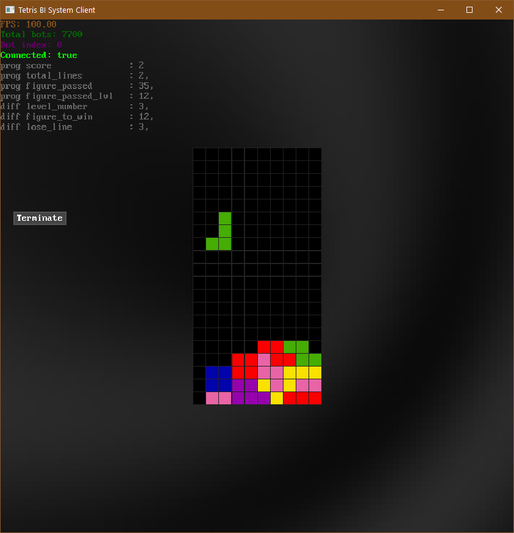
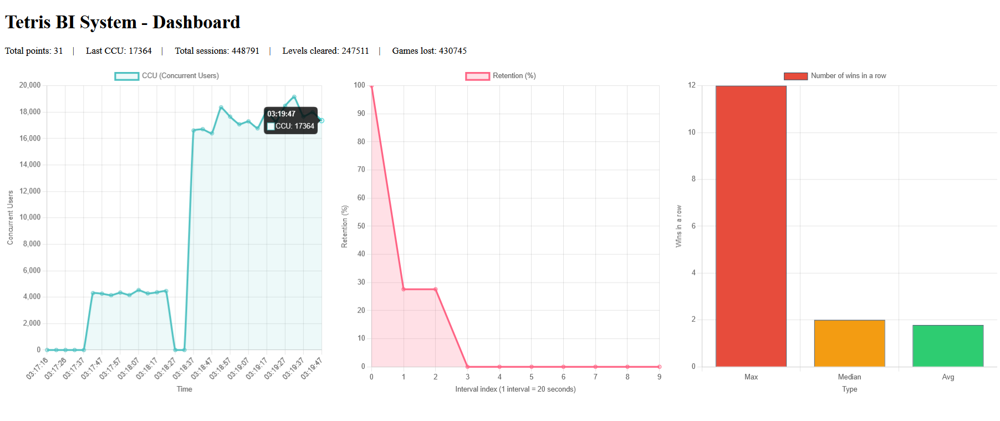

# Tetris-BI-System

> <b>Project:</b> SPb HSE Computer Games Programming & Engineering, 1st course 2025/26 Project, Tetris Game with Business Intelligence System \
> <b>Authors:</b> Nikita Koptelov, Artem Vysotin \
> <b>Project start:</b> Feb 2026 \
> <b>Project end:</b> May 2026 \
> <b>Academic director:</b> Ilya Pshenichniy

<b>Brief description:</b> project consists of tetris client written on C++ with options to play manually or launch thousands of bots, including up to 100 smart ones, and built-in BI system (PostgreSQL database, server on Python and dashboard page).

## Screenshots

 \

## Features
- Playable Tetris ("Play Manually"): <sb>move:</sb> A/D, rotate: W/S, drop: space, start/end session: Ctrl+(S/E)
- Bot farm ("Run bot simulation"): up to 100k simple bots and 100 "clever" bots that search all
  rotations/positions and penalize holes
- Live dashboard (http://127.0.0.1:5837): CCU(t), total sessions, levels cleared, games lost,
  rolling retention, win-streak (levels cleared streak) stats (max/median/avg)

## Architecture
- Client (C++20): WebSocket -> Server
- (Dashboard: Chart.js) <- (Server: FastAPI) -> (Database: PostgreSQL)

## Tech stack
C++20, CMake, MiniFB, IXWebSocket, nlohmann/json, miniaudio ·
Python, FastAPI, psycopg2 · PostgreSQL · Chart.js

## Getting started
1. Clone: `git clone <this repo>`
2. Database: create some DB, then run in order:
   `Database/create/*.sql`, `Database/optimizations.sql`
3. Server: install requirements, set DB enviroment variables (see `DB_CONFIG`in `Server/server.py`), run `python Server/server.py`
4. Client: `cd Client && cmake -B build && cmake --build build`, run `Tetris`
5. Open http://127.0.0.1:5837 for the dashboard

## Project structure
`Client/` game and bots · `Server/` API and dashboard · `Database/` SQL scripts

## Contribution
- <b>Nikita Koptelov (NK1):</b> setup, window, render, UI, stats sender, database, dashboard
- <b>Artem Vysotin (AV1):</b> tetris logic, tetris bot logic, database, dashboard
## License
MIT